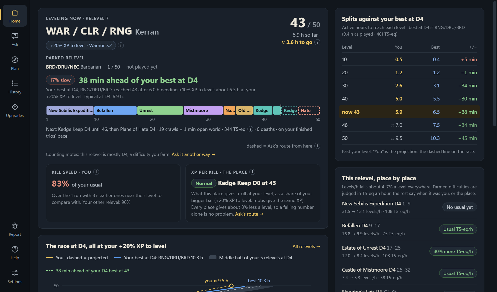
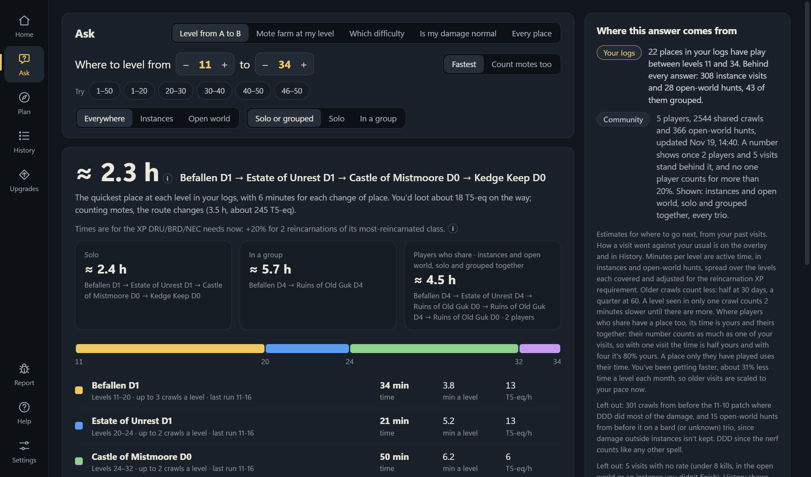
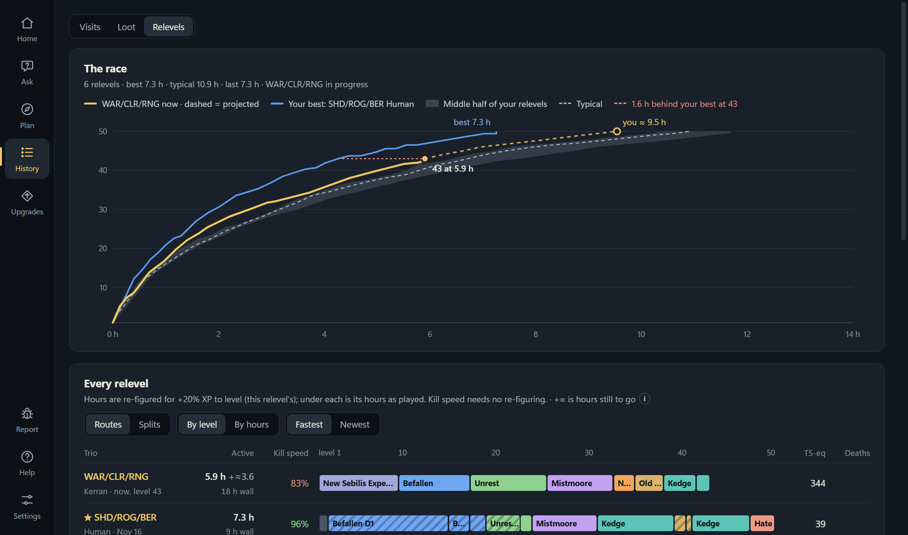
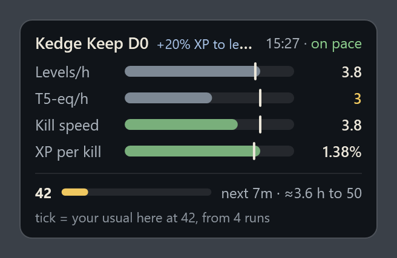
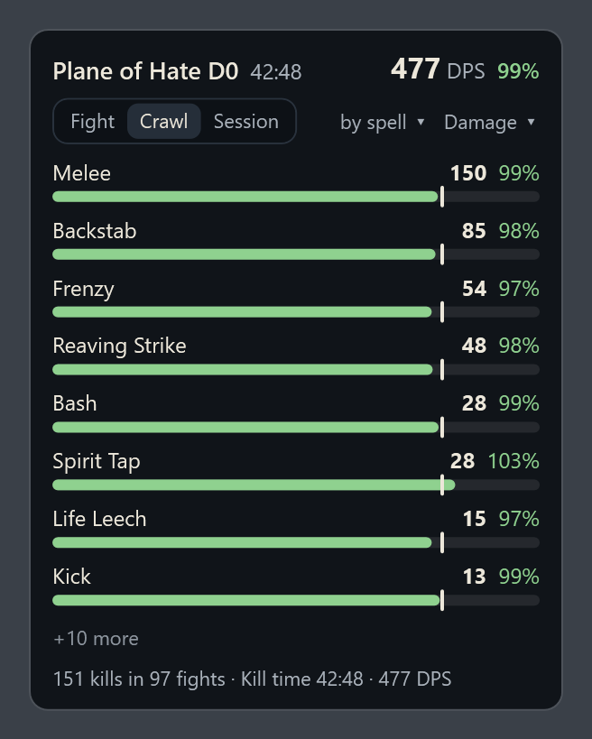

```text
   E Q L
    ____        __  __    _____           __
   / __ \____ _/ /_/ /_  / __(_)___  ____/ /__  _____
  / /_/ / __ `/ __/ __ \/ /_/ / __ \/ __  / _ \/ ___/
 / ____/ /_/ / /_/ / / / __/ / / / / /_/ /  __/ /
/_/    \__,_/\__/_/ /_/_/ /_/_/ /_/\__,_/\___/_/

   Relevel faster.
```

# EQL Pathfinder

A Windows companion for EverQuest Legends. It reads the log the game already writes and shows the fastest way to 50
for the trio you're on, timed from your own kills, not guesswork.

**[Download for Windows](https://eqlpathfinder.com)** · [What's new](https://eqlpathfinder.com/changelog) ·
[Privacy](https://eqlpathfinder.com/privacy) · [Discord](https://eqlpathfinder.com/discord)

`Free` · `Windows 10 and 11` · `Signed installer, updates itself` · `MIT`



## It starts with your log

Type `/log on` in the game and it writes a line for everything that happens to you:

```text
[Sat Nov 14 00:40:12 2026] You have entered The Estate of Unrest 4 (Refined).
[Sat Nov 14 00:40:58 2026] You gain experience! (4.735%)
[Sat Nov 14 00:40:58 2026] You have slain a tentacle terror!
[Sat Nov 14 00:58:31 2026] You gained reward experience from the Dungeon Crawl!
[Sat Nov 14 00:58:33 2026] You looted 3 Mote of Major Potential from Reward Chest and stored it in your currency
```

Pathfinder turns those lines into crawls, levels, kill speed and loot, and compares each run with your own usual in
the same place at the same level. Every line it understands is listed in [docs/log-formats.md](docs/log-formats.md).

## What it does

- **Ask: where should I level next?** Pick a level range and Ask lays out the fastest route, place by place, timed
  from your own runs and adjusted for the extra XP each reincarnation needs. It also answers the best mote farm at
  your level, which difficulty is worth it, and whether your damage is normal for the place.
- **An overlay while you play.** Levels per hour, kill speed and XP per kill against your usual at this place and
  level. When you fall behind, it says whether it's you or the place.
- **A fight meter.** Damage by fighter, spell and mob for each pull, crawl or session. Your pets count as you.
- **Relevels and Campaign.** Every relevel is a line on a race chart, with splits and where its hours went. Campaign
  lays out every reincarnation toward the passive ranks you want and ticks runs off as your log sees them.
- **History and Loot.** Every crawl, raid and open-world hunt with its time, levels per hour, kills, deaths and a
  verdict against your usual there. Loot keeps every mote and fragment by tier, with drop rates.
- **Upgrades.** The cheapest way to raise an item or spell with the motes and fragments you have.
- **Better together (optional).** Where your own logs are thin, Ask answers from players who share their numbers,
  and says how many players stand behind each one.

| Ask | Relevels |
|---|---|
|  |  |

| The overlay | The fight meter |
|---|---|
|  |  |

## Get started

1. **Install.** [Download](https://eqlpathfinder.com) and run the installer. It installs for your Windows account
   only, with no admin rights. Windows may say *Windows protected your PC* the first time: click **More info**, then
   **Run anyway**. [Why](https://eqlpathfinder.com/#windows-warning).
2. **Turn your log on.** In EverQuest Legends, type `/log on`. The welcome tour checks that it's working.
3. **Play.** Pathfinder reads your history once (a few minutes for a big log), then keeps up as you play.

## It reads. It never touches the game.

- **Only reads.** The log, the game's spell list and your `/outputfile inventory` export. It never changes the
  game, its files or its memory, and it automates nothing ([docs/game-memory.md](docs/game-memory.md) has the why).
- **Stays on your PC.** Your log, your character's name and your chat never leave it. What Pathfinder works out is
  kept in `%LocalAppData%\EQL Pathfinder\`.
- **Three things can leave, and you can see each one before it goes:**
  - anonymous usage counts: only if you say yes when you set it up, with a switch that also deletes what your copy sent;
  - your play's numbers, if you choose to share: off until you turn it on, and never names, chat or clock times;
  - feedback and reports: only when you send them.

The whole promise is on the [privacy page](https://eqlpathfinder.com/privacy) (`site/privacy.html`), and the server
that receives those three things is in [`server/`](server/), so you can hold the page to the code.

## How it counts

- **Active time.** Rates leave out the minutes you weren't fighting.
- **T5-eq.** Every mote and fragment in one unit: one Major mote = 1
  ([docs/motes-and-fragments.md](docs/motes-and-fragments.md)).
- **Your usual.** A run is compared with your own runs in the same place at the same level, like with like
  ([docs/pace.md](docs/pace.md)).

Every number a player sees, how it's worked out and the test that holds it to a hand-checked value:
[docs/calculations.md](docs/calculations.md).

## Build from source

You need Windows 10 or 11, the .NET 10 SDK and Microsoft Edge (the page tests open the app's pages in headless
Edge). Node.js is for the page-script check, `server/` and `site/`.

```powershell
dotnet build EQLPathfinder.slnx
dotnet test tests/EqlPathfinder.Engine.Tests

# The app. EQLPATHFINDER_DATA gives this copy its own settings and database, beside an installed one.
$env:EQLPATHFINDER_DATA = "$env:TEMP\pathfinder-dev"
dotnet run --project src/EqlPathfinder.App

# The command line: the same engine, without a window.
dotnet run --project src/EqlPathfinder.Cli -- upgrade --tier 5 --goal 10

# The gate every change passes: the build, every test, the page scripts.
.\tools\check.ps1
```

The server's tests run against a local database (`cd server; npm install; npm test`), and the website builds with
`cd site; npm install; npm run build`. See [CONTRIBUTING.md](CONTRIBUTING.md) for development notes and
[SECURITY.md](SECURITY.md) for reporting security issues.

## Layout

| Where | What it is |
|---|---|
| `src/EqlPathfinder.Engine` | The parser, the tracker (visits, levels, loot, damage), the analysis behind Ask, the SQLite store. No UI, no Windows APIs. |
| `src/EqlPathfinder.App` | The WPF app: tray icon, overlays, first-run setup, and the main window's pages (WebView2, `web/`). |
| `src/EqlPathfinder.Cli` | `pathfinder`, the command line: answers from a log or a database, and the job that builds the community numbers. |
| `tests/EqlPathfinder.Engine.Tests` | Engine tests, page tests, and golden tests on scrubbed real-log fixtures. |
| `server/` | The community API: a Cloudflare Worker and its database. |
| `site/` | The website, [eqlpathfinder.com](https://eqlpathfinder.com). |
| `infra/` | The domain, caching and code signing, as Terraform and Bicep. |
| `tools/` | The gate, the worktree script and the release pipeline ([docs/pipeline.md](docs/pipeline.md)). |
| `docs/` | How everything works. Start at [docs/README.md](docs/README.md). |
| `CLAUDE.md`, `.claude/` | The rules, roles and how-tos for the AI agents that work on this (below). |

## How it's built

One player builds Pathfinder with a small crew of AI agents (Claude Code): a designer, a QA lead, an engineer and an
architect, each with a page of rules. Every change is sized first, gets a spec and a failing test before the fix, and
is reviewed before it reaches main. Whatever is on main is built, tested, signed and released within the hour.

- [CLAUDE.md](CLAUDE.md): the rules.
- [docs/roles.md](docs/roles.md): who does what, why, and what it costs.
- [docs/specs/](docs/specs/): every change's spec, decisions and reviews.
- [docs/releases/](docs/releases/): every version's notes.

## Feedback

- **Report a problem** in the app (or Ctrl+Shift+R) is the best way to report a bug: it brings a screenshot of the
  page, with your character's name, clock times and folders hidden, and you see it before it goes.
- **Help → Send feedback** for ideas; **Help → Your reports** shows what happened to yours.
- **[GitHub issues](https://eqlpathfinder.com/github/issues)** for anything you'd rather discuss in the open, and
  **[Discord](https://eqlpathfinder.com/discord)** to talk with other players.
- **Pull requests:** please open an issue first. This repository is a copy of the one Pathfinder is built in, so
  changes are carried over by hand.

## License

[MIT](LICENSE). The Cinzel font is under the SIL Open Font License (`OFL-Cinzel.txt`, beside each copy of the font).

EQL Pathfinder is a fan-made tool. It isn't made or endorsed by Daybreak Game Company. EverQuest is a registered
trademark of Daybreak Game Company LLC.
